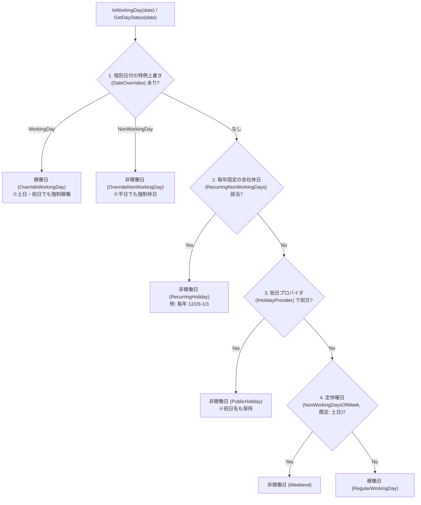
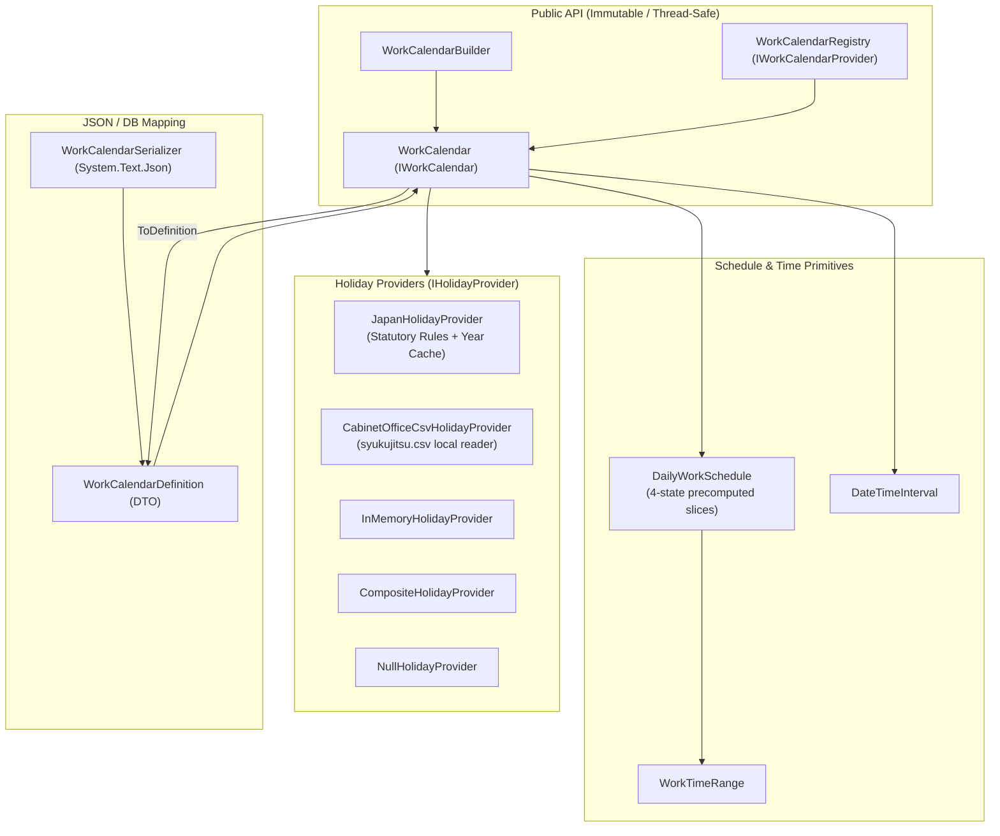

# WorkTimeCalc — 稼働日・稼働時間算出ライブラリ 設計・実装計画

## 1. ゴールと設計方針

C# / .NET 向けの稼働日・実稼働時間算出ライブラリ `WorkTimeCalc` を構築します。

### 主な要件
- **マルチターゲット (`net8.0;netstandard2.0`)**:
  - `.NET 8.0+`: `DateOnly` / `TimeOnly` オーバーロードを含むモダン API（外部 NuGet 依存ゼロ）
  - `.NET Standard 2.0`: `.NET Framework 4.8` 等からも `DateTime` / `TimeSpan` ベースで同一機能を利用可能（公式 `System.Text.Json 8.0.5` のみ参照）
- **稼働時間・複数休憩・日跨ぎ稼働（夜勤）**:
  - `08:00-17:00`（休憩 `12:00-13:00`, `15:00-15:10`）のような日勤だけでなく、`22:00-翌06:00`（休憩 `02:00-03:00` や `23:30-00:30`）のような日跨ぎシフトや 24 時間稼働を正確に算出
- **日本の祝日判定＋外部データ差し替え**:
  - 「国民の祝日に関する法律」に基づく計算エンジン（固定祝日・ハッピーマンデー・春分/秋分日近似式・振替休日・国民の休日・歴史的特例）を内蔵
  - 将来の法改正等に備え、内閣府 `syukujitsu.csv` やメモリ/DBデータへの差し替え・年範囲フォールバック合成に対応
- **柔軟な特例上書き**:
  - 休日出勤・祝日稼働（非稼働日→稼働日）、会社独自休日・夏季休暇・年末年始（稼働日→非稼働日）を明確な 4 段階優先順位で制御
- **複数カレンダー・DI・JSON/DB連携**:
  - イミュータブルかつスレッドセーフな `WorkCalendar`
  - 工場・部署・ライン・シフト別管理の `WorkCalendarRegistry`
  - JSON 設定ファイルや DB レコードと相互変換できる `WorkCalendarDefinition` DTO

---

## 2. 設計判断・境界仕様

### 2.1 日跨ぎ稼働（夜勤）の基準日ルールと深夜休憩の解釈
- **始業日基準**: たとえば「金曜が稼働日・土曜が非稼働日」で夜勤シフト `22:00-06:00` の場合、金曜のシフトは **金曜 22:00 〜 土曜 06:00** に稼働します。
  - `IsWorkingDay(土曜日)` は `false`（土曜始業のシフトはない）
  - `IsWorkingTime(土曜 01:00)` は `true`（金曜始業シフトの稼働時間帯内）
  - 逆に「日曜が非稼働日・月曜が稼働日」の場合、`IsWorkingTime(月曜 01:00)` は `false`（日曜始業シフトがないため）となり、月曜 22:00 から稼働開始します。
- **時刻表記**: `WorkTimeRange` は `22:00-06:00`（終了 ＜ 開始なら自動的に翌日 `30:00` 扱い）と `22:00-30:00`（24時間超表記）の両方を受理します。
- **深夜休憩の自動補正**: 夜勤 `22:00-06:00` に対して休憩 `02:00-03:00` を指定した場合、シフト内の `26:00-27:00` として自動的に適用します（`26:00-27:00` や日跨ぎ休憩 `23:30-00:30` の直接指定も可）。

### 2.2 時刻・期間の境界条件
- **半開区間 `[Start, End)`**: 稼働 `08:00-17:00`、休憩 `12:00-13:00` のとき、`IsWorkingTime(08:00) == true`、`IsWorkingTime(12:00) == false`、`IsWorkingTime(13:00) == true`、`IsWorkingTime(17:00) == false`。
- **`AddWorkingTime` の完了境界と `TimeSpan.Zero`**:
  - `AddWorkingTime(08:00, 4h)` → `12:00`（休憩開始直前に完了するため `13:00` へ飛ばさない）
  - `AddWorkingTime(08:00, 4h + 1m)` → `13:01`
  - `AddWorkingTime(17:00, -4h)` / `SubtractWorkingTime(17:00, 4h)` → `13:00`（順算と完全対称）
  - `AddWorkingTime(dt, TimeSpan.Zero)` → `dt` をそのまま返却（次の稼働開始時刻へ寄せる場合は `GetNextWorkingTime(dt)` を使用）
- **`CountWorkingDays(start, end)` / `GetWorkingDays(start, end)`**:
  - **開始日・終了日の両端を含む（閉区間）**（例: 月〜金がすべて稼働日なら `5日`、月〜月なら `1日`）。`end < start` の場合は `ArgumentOutOfRangeException`。
- **`GetWorkingTime(start, end)`**:
  - `start <= end` は非負の `TimeSpan`、`start > end` は負の `TimeSpan`（`-GetWorkingTime(end, start)`）。

### 2.3 稼働日判定の 4 段階優先順位



---

## 3. アーキテクチャ概要



### 日跨ぎ対応アルゴリズム（4 状態事前計算）
任意の暦日 `D`（`[D 00:00, D+1 00:00)`）における実効稼働時間帯は、「前日 `D-1` の稼働有無 × 当日 `D` の稼働有無」の **4 パターン** で一意に決まります。
`DailyWorkSchedule` 生成時に全稼働帯から全休憩帯を差し引いた `EffectiveWorkingRanges` を確定し、次の 4 配列を事前計算します。
1. `Neither`: 空
2. `SameDayOnly`: 当日分 `[00:00, 24:00)` クリップ済み区間（例: 月曜夜勤 `[22:00-24:00)`）
3. `SpilloverOnly`: 前日シフトの翌日繰り越し分（`End > 24:00` を `-24h` シフト、例: 土曜早朝 `[00:00-02:00), [03:00-06:00)`）
4. `BothDays`: `SpilloverOnly` と `SameDayOnly` をソート・隣接マージした区間

実行時は 4 パターンから O(1) で参照するため、24時間稼働や重複休憩・日跨ぎ境界での重複計上や無限ループを防ぎます。

---

## 4. ディレクトリ構成

```text
WorkTimeCalc\
├── docs\
│   └── implementation-plan.md
└── src\
    ├── WorkTimeCalc.slnx
    ├── WorkTimeCalc\
    │   ├── WorkTimeCalc.csproj              (net8.0;netstandard2.0)
    │   ├── Polyfills\
    │   │   └── IsExternalInit.cs
    │   ├── Internal\
    │   │   └── TimeFormatHelper.cs
    │   ├── Models\
    │   │   ├── WorkTimeRange.cs
    │   │   ├── DateTimeInterval.cs
    │   │   ├── DailyWorkSchedule.cs
    │   │   ├── DayStatus.cs
    │   │   ├── MonthDay.cs
    │   │   └── DateOverride.cs
    │   ├── Holidays\
    │   │   ├── HolidayInfo.cs
    │   │   ├── IHolidayProvider.cs
    │   │   ├── JapanHolidayProvider.cs
    │   │   ├── CabinetOfficeCsvHolidayProvider.cs
    │   │   ├── InMemoryHolidayProvider.cs
    │   │   ├── CompositeHolidayProvider.cs
    │   │   └── NullHolidayProvider.cs
    │   ├── Serialization\
    │   │   ├── WorkCalendarDefinition.cs
    │   │   └── WorkCalendarSerializer.cs
    │   ├── IWorkCalendar.cs
    │   ├── WorkCalendar.cs
    │   ├── WorkCalendarBuilder.cs
    │   ├── IWorkCalendarProvider.cs
    │   └── WorkCalendarRegistry.cs
    └── WorkTimeCalc.Tests\
        ├── WorkTimeCalc.Tests.csproj        (net8.0 + xUnit)
        ├── JapanHolidayProviderTests.cs
        ├── HolidayProviderCompositionTests.cs
        ├── DailyWorkScheduleTests.cs
        ├── WorkCalendarDayTests.cs
        ├── WorkCalendarTimeTests.cs
        └── SerializationAndRegistryTests.cs
```

---

## 5. 日本の祝日エンジン (`JapanHolidayProvider`) の対応範囲

- **固定祝日・ハッピーマンデー**: 成人の日（1999年以前 `1/15`・2000年以降 1月第2月曜）、海の日（1996〜2002 `7/20`・2003年以降 7月第3月曜）、敬老の日（1966〜2002 `9/15`・2003年以降 9月第3月曜）、体育の日／スポーツの日（1966〜1999 `10/10`・2000〜2019 10月第2月曜・2022年以降 10月第2月曜）ほか
- **天皇誕生日**: 昭和（1949〜1988 `4/29`）、平成（1989〜2018 `12/23`）、2019年なし、令和（2020年以降 `2/23`）
- **春分の日・秋分の日**: 国立天文台準拠の近似式（1948〜2150年対応）
- **2020年・2021年 東京五輪特措法**: 海の日・山の日・スポーツの日の移動（および 2021/8/9 振替休日）
- **歴史的一回限り祝日**: 1959/4/10、1989/2/24、1990/11/12、1993/6/9、2019/5/1（天皇の即位の日）、2019/10/22（即位礼正殿の儀）
- **振替休日**: 1973/4/12〜2006年ルールおよび 2007年以降の「最初の非祝日の平日へ繰越」ルール（2026年 GW `5/6` 振替に対応）
- **国民の休日**: 1986年以降のサンドイッチルール（2019年 GW `4/30`, `5/2`、2026年シルバーウィーク `9/22` 等に対応）

---

## 6. 利用イメージ

### C# Fluent Builder
```csharp
var calendar = WorkCalendar.CreateBuilder()
    .WithId("factory-a-day")
    .WithName("第1工場 日勤")
    .WithWorkingHours(TimeSpan.FromHours(8), TimeSpan.FromHours(17))
    .AddBreak(TimeSpan.FromHours(12), TimeSpan.FromHours(13))
    .AddBreak(new TimeSpan(15, 0, 0), new TimeSpan(15, 10, 0))
    .AddWorkingDayOverride(new DateTime(2026, 5, 4), "GW休日出勤")
    .AddNonWorkingDayOverride(new DateTime(2026, 8, 14), "夏季休暇")
    .Build();
```

### JSON 設定例（夜勤・年末年始・特例上書き）
```json
[
  {
    "id": "factory-night",
    "name": "第1工場 夜勤",
    "workingPeriods": [{ "start": "22:00", "end": "06:00" }],
    "breaks": [{ "start": "02:00", "end": "03:00" }],
    "nonWorkingDaysOfWeek": ["Saturday", "Sunday"],
    "useJapanHolidays": true,
    "recurringNonWorkingDays": [
      { "month": 12, "day": 29, "reason": "年末年始" },
      { "month": 12, "day": 30, "reason": "年末年始" },
      { "month": 12, "day": 31, "reason": "年末年始" }
    ],
    "dateOverrides": [
      { "date": "2026-05-04", "isWorkingDay": true, "reason": "祝日稼働" }
    ]
  }
]
```

---

## 7. 検証コマンド

```powershell
$env:DOTNET_CLI_TELEMETRY_OPTOUT = "1"
dotnet restore src/WorkTimeCalc.slnx --source "$env:USERPROFILE\.nuget\packages"
dotnet build src/WorkTimeCalc.slnx -c Release --no-restore
dotnet test src/WorkTimeCalc.slnx -c Release --no-build --verbosity normal
```

---

## 8. 残業計算拡張（OvertimePolicy / WorkingTimeBreakdown / OvertimePeriods）

稼働日判定・稼働日計算は定時ベース（`IsWorkingDay` 等は変更なし）のまま、以下の 2 方式を残業ポリシー `OvertimePolicy` で統一的に扱えるよう拡張しています。

1. **呼び出し時の動的残業（定時のみカレンダーでも利用可能）**:
   - `OvertimePolicy.MaxPerDay(TimeSpan)`: 各稼働日の定時終了後に指定時間まで残業を動的延長（`DailyWorkSchedule.Breaks` を自動控除）。上限超過分は翌稼働日へ繰り越し。
   - `OvertimePolicy.Unlimited`: 1 日の上限なしで定時終了後へそのまま延長（`Breaks` は継続適用、非稼働日・始業前開始時は次の定時開始時刻へスナップしてから延長）。
2. **カレンダー事前定義の残業枠（`DailyWorkSchedule.OvertimePeriods`）**:
   - `WorkCalendarBuilder.WithOvertimeHours` / `AddOvertimeHours` / `AddOvertimePeriod` および `WorkCalendarDefinition.OvertimePeriods`（JSON）で事前定義。
   - `OvertimePolicy.CalendarDefined` 指定時に定時＋残業枠で計算し、`IsOvertime(DateTime)` で事前定義残業帯を判定可能。
3. **既存 API の完全後方互換と内訳取得**:
   - 既存メソッド（`OvertimePolicy` 省略時）は既定で `OvertimePolicy.None`（定時のみ）を維持。
   - `GetWorkingTimeBreakdown(start, end, [overtimePolicy])` により `WorkingTimeBreakdown`（`Regular` / `Overtime` / `Total`）を取得可能。
